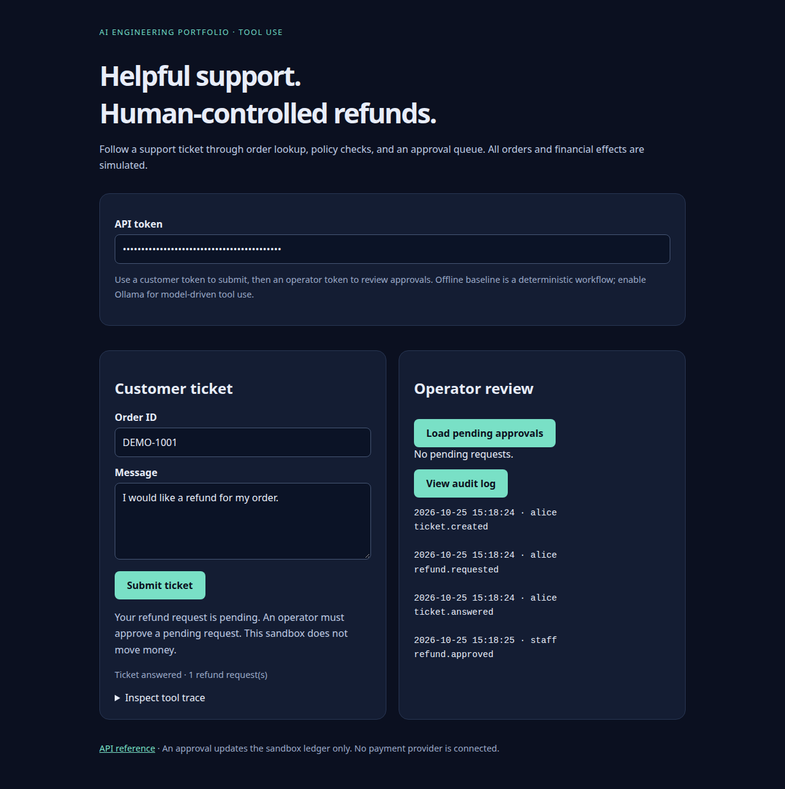
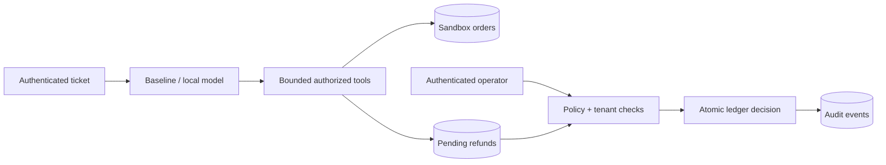

# SupportPilot

**A tool-using support assistant with human-controlled sandbox refunds.**





Submit a support ticket, inspect the agent's tool trace, and review staged refunds as an
operator. The default deterministic baseline runs offline. Optional Ollama tool calling
lets a local language model choose among a deliberately small set of tools.

## What this demonstrates

- Bounded model/tool loops, explicit failure states, and an inspectable deterministic baseline.
- Server-bound account and order scope: models cannot choose another user's order.
- An approval queue with role checks, transactional decisions, policy rechecks, and idempotent replay.
- Persistent tickets, sandbox orders, refund requests, and an audit log.
- Concurrency, authorization, policy, provider failure, and forbidden-tool regression tests.

## Run locally

```bash
python -m venv .venv
source .venv/bin/activate
pip install -e '.[dev]'
cp .env.example .env
```

Replace the customer and operator tokens in `.env` with random values generated by
`python -c 'import secrets; print(secrets.token_urlsafe(32))'`.
The example identities use workspace `demo`, customer `alice`, and operator `staff`.

```bash
python -m supportpilot.seed --tenant demo --user alice
uvicorn supportpilot.api:create_app --factory --env-file .env --host 127.0.0.1 --port 8001
```

Seeding uses `DB_PATH` from the shell, defaulting to `data/app.db`. If you change the database
path in `.env`, also export that same `DB_PATH` before running the seed command.
Open <http://127.0.0.1:8001>. Paste the customer token and request a refund for `DEMO-1001`.
Then switch to the operator token, load pending approvals, and approve or reject.
An approval changes the sandbox order to `refunded`. **No payment provider is connected and no money moves.**

## Optional local agent

Install [Ollama](https://docs.ollama.com/), pull `qwen2.5:3b`, and add to `.env`:

```dotenv
AGENT_BACKEND=ollama
OLLAMA_URL=http://127.0.0.1:11434
OLLAMA_MODEL=qwen2.5:3b
```

Restart the server. Available tools are `lookup_order`, `get_policy`, and `request_refund`.
There is no approval tool. Tool calls accept no account or order arguments: the server binds
them to the authenticated customer and the submitted order. The loop stops after five model
turns or six tool calls. Network timeouts and malformed responses are explicit errors.
Retries are manual: failed tickets remain visible and pending requests survive a provider failure.

## Architecture and invariants



A model can propose a pending refund but cannot apply it. Approval rechecks the 30-day
delivery policy inside a write transaction. An order has at most one refund request;
repeated identical decisions return success without another audit effect. Changing an
already finalized decision returns `409`. Rejected requests require human follow-up;
the demo deliberately has no reopen flow.

## Validate and package

```bash
ruff check .
ruff format --check .
pytest --cov=src --cov-report=term-missing
docker build -t supportpilot .
docker volume create supportpilot-data
docker run --rm -p 127.0.0.1:8001:8000 --env-file .env -e DB_PATH=/app/data/app.db -v supportpilot-data:/app/data supportpilot
```

For a container demo, seed the same named volume first with
`docker run --rm --env-file .env -e DB_PATH=/app/data/app.db -v supportpilot-data:/app/data supportpilot python -m supportpilot.seed`.
See [validation](docs/VALIDATION.md) for checks actually run.

## Limits and CV wording

This is a locally validated portfolio application with static development identities and a
simulated commerce integration. Model prose can still be inaccurate; the enforced guarantee
concerns ledger writes, not every natural-language claim. Audit events share the same SQLite
database and are not tamper-proof. Public deployment needs real identity, rate limiting,
durable backups, monitoring, and a real payment integration with provider idempotency.

Suggested CV wording: “Implemented a tool-using support workflow with server-enforced
authorization, approval-gated sandbox refunds, persistent audit events, and concurrent
decision tests.” Do not claim live payment processing or real customer resolution rates.

MIT licensed. See [security](SECURITY.md), [architecture](docs/ARCHITECTURE.md), and
[contributing](CONTRIBUTING.md).

## Browser validation

```bash
pip install -e '.[browser]'
playwright install chromium
python scripts/browser_smoke.py
```

This starts a disposable local server, exercises the UI, checks the 390 px mobile layout,
and saves screenshots. A matching browser check runs in GitHub Actions.

Validate the container with disposable volumes and accounts:

```bash
docker build -t supportpilot:portfolio .
python scripts/container_smoke.py
```
