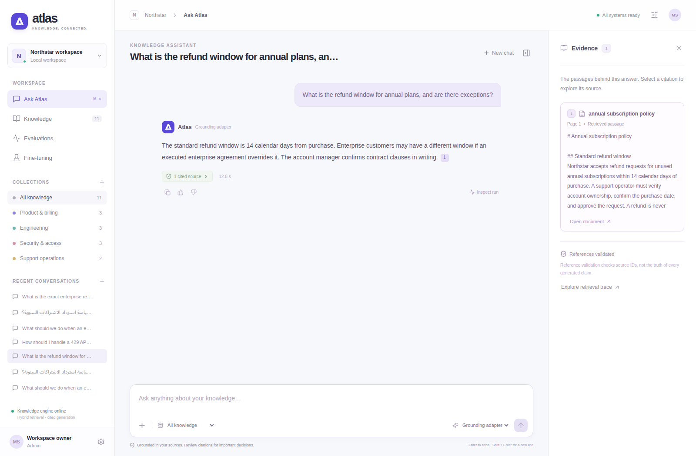

# Atlas RAG Studio

**A knowledge workspace that retrieves evidence, generates cited answers, and fine-tunes the model's grounding behavior.**




Atlas replaces the earlier SupportPilot demo. The previous implementation is preserved at the
`supportpilot-v0.1.0` Git tag. The new application uses a separate database and leaves legacy sandbox data untouched.

## What is actually AI here?

Every successful model answer follows the complete RAG path:

```text
PDF / Markdown / text
  → isolated extraction → page-aware passages → multilingual E5 embeddings → persistent Qdrant
Question + optional conversation context
  → native lexical search + dense search → reciprocal-rank fusion → learned cross-encoder reranking
  → context budgeting → base or LoRA-adapted language model → streamed draft → reference validation
```

There is no extractive answer mode or rule-based answer fallback. If evidence is insufficient,
Atlas abstains. If generated references are invalid, the draft is rejected instead of saved as an answer.
Reference validation checks IDs and paragraph-level citation presence; it does not prove semantic truth.

**Fine-tuning changes behavior:** use the supplied evidence, cite it, answer in the question's language,
and decline unsupported questions. **Retrieval supplies changing facts:** updating a policy does not
require retraining the model.

## Recorded development results

On a fixed-seed **20/80 held-out sample**, the 128-step LoRA run improved structural citation validity
from **10% to 80%** and lexical reference fact coverage from **57.5% to 77.5%**. The full 80-case
retrieval run recovered every expected source in the top five for its 64 answerable cases.
These are original synthetic-fixture measurements; citation formatting and lexical overlap do not
establish semantic accuracy. Arabic quality and complete procedural answers remain limitations.
See [raw reports](reports/) and the [answer review](docs/RESPONSE_REVIEW.md).

## Product experience

- React + TypeScript workspace, responsive navigation, accessible dialogs, and a pinned chat composer.
- Conversation history, collection scoping, cancellation, feedback, and idempotent message requests.
- PDF/Markdown/text upload, duplicate detection, durable indexing jobs, retries, source preview and download.
- Clickable citations with page-level passages; a separate inspector shows retrieval candidates and timings.
- Evaluation comparisons and training curves populated only from recorded runs.
- A real base/adapter toggle; adapted mode is unavailable until a grounding adapter is loaded.

## Engineering choices

| Concern | Implementation |
| --- | --- |
| Dense retrieval | `intfloat/multilingual-e5-small`, query/passage prefixes, normalized embeddings |
| Lexical retrieval | SQLite FTS5/BM25 locally; PostgreSQL native full-text search in deployment |
| Hybrid ranking | Reciprocal-rank fusion, followed by multilingual mMARCO cross-encoder reranking |
| Vector persistence | Embedded Qdrant locally; authenticated Qdrant server via configuration |
| Metadata | SQLAlchemy, SQLite or PostgreSQL; workspace-scoped sources and user-private conversations |
| Generation | Pinned Qwen2.5-0.5B-Instruct for CPU validation; configurable compatible API for larger models |
| Adaptation | Response-only rank-8 LoRA; optional NF4 QLoRA on a CUDA GPU |
| Identity | Explicit local-computer workspace; verified OIDC JWT claims for hosted deployments |
| PDF parsing | Separate process with Linux memory/CPU limits and a wall-clock timeout |

The default 0.5B model is a CPU development choice, not a claim of enterprise answer quality.
Larger models and hosted inference can use the same retrieval and evaluation path.

## Run locally

Use Python 3.11/3.12 and Node.js 22.12 or newer.

```bash
python -m venv .venv
source .venv/bin/activate
pip install torch --index-url https://download.pytorch.org/whl/cpu
pip install -e '.[models,dev,browser]'
cp .env.example .env
python scripts/download_models.py
python scripts/download_adapter.py  # Published development adapter, or train your own below
npm ci --prefix frontend
npm run build --prefix frontend
python -m atlas_rag.seed
uvicorn atlas_rag.api:create_app --factory --host 127.0.0.1 --port 8001
```

Open **http://localhost:8001**. Local mode needs no API token. It is restricted to loopback clients
and local hostnames. Models initialize in the background; uploaded sources are indexed when the
engine becomes ready. Downloads are pinned and may take time on a slow connection.

Try these questions against the original fictional Northstar documents:

- “What is the refund window for annual plans, and are there exceptions?”
- “How should I handle a 429 API response?”
- “What should we do when an employee reports a compromised account?”
- “ما سياسة استرداد الاشتراكات السنوية؟”
- Ask for an undocumented fact to inspect abstention behavior.

Source files are fictional demonstration data. They do not describe a real organization's policies.
The checksum-pinned adapter is distributed as a release asset, separately from source code.
Its training report describes the synthetic fixture and development limitations.
For frontend development, `npm run dev --prefix frontend` proxies API requests to port 8001.

## Train the grounded answer model

```bash
python scripts/create_dataset.py
python -m atlas_rag.training --steps 128 --grad-accum 1 --max-length 640 --register
```

The original fixture has **240 training / 60 validation / 80 test examples**. Organization groups
are separated before bilingual expansion. Counterfactual policy values make the model read the
context. Task templates recur across groups; this is explicitly not an unseen-domain benchmark.

Prompt tokens are masked from supervision. Complete answer tokens receive the loss. Reports record
model revision, dataset hashes, seed, optimizer steps, parameter count, versions and validation loss.
Training is a separate process. Restart model serving after replacing the adapter so the loaded
weights and displayed run state agree.

For compatible CUDA hardware, install `pip install -e '.[qlora]'` and add `--qlora`.
The GPU path must be validated on the target hardware; see the recorded validation boundaries.

## Evaluate actual retrieval and generation

```bash
python -m atlas_rag.evaluate --mode all --register
# Smaller, explicitly sampled smoke workload:
python -m atlas_rag.evaluate --mode all --limit 12 --output reports/evaluation-smoke.json --register
```

The evaluator creates an isolated corpus and vector index, compares lexical/dense/hybrid/reranked
retrieval, then runs the same questions through base and adapted generation. It measures recall@5,
MRR, reference validity, abstention, reference fact coverage and stage timings. It prints progress.
The fact-coverage check is a lexical proxy; human review is still needed for correctness and safety.
Registered reports appear in the Evaluations tab. No dashboard numbers are fabricated.

## Checks

```bash
ruff check .
ruff format --check .
pytest --cov=src --cov-report=term-missing
npm run check --prefix frontend
npm run format:check --prefix frontend
npm test --prefix frontend
npm audit --prefix frontend --audit-level=moderate
npm run build --prefix frontend
playwright install chromium
python scripts/browser_smoke.py
```

CI browser tests substitute neural components to avoid model downloads; authorization, SQL,
Qdrant, file processing, API routes and the browser UI are real. Separate recorded local runs
exercise the actual embedding, reranking, base and adapted generation models.
See [validation](docs/VALIDATION.md) for exact commands and outcomes, and
[actual answer review](docs/RESPONSE_REVIEW.md) for observed omissions and language failures.

## PostgreSQL + Qdrant deployment shape

Set fresh `ATLAS_POSTGRES_PASSWORD` and `ATLAS_QDRANT_API_KEY` in your ignored `.env`, then:

```bash
docker compose up --build -d
docker compose exec app python -m atlas_rag.seed
```

The default compose port is bound to localhost. Local mode trusts the local Docker bridge range
for that loopback-only setup. Public deployment requires `ATLAS_AUTH_MODE=oidc`, issuer/audience/JWKS,
your actual hostname, TLS, request limits, resource sizing and backup/restore validation.
PostgreSQL and Qdrant do not publish their ports in compose.

Use `ATLAS_LLM_BACKEND=compatible`, `ATLAS_LLM_BASE_URL`, `ATLAS_MODEL_ID` and optional
`ATLAS_ADAPTER_MODEL` to serve generation through a vLLM/TGI-compatible endpoint. Provider keys
stay server-side. The local CPU model and an external endpoint are explicit choices; no backend
silently substitutes a deterministic answer generator.

## Scope and limits

This is a substantial, locally validated portfolio system. It is not a deployment sized for millions
of users. The CPU runtime serializes generation, and the default ingestion worker shares one
application process. Embedded Qdrant supports a single application process; use server mode for
multiple replicas. An external inference fleet, distributed job workers, calibrated rejection
thresholds, rate limiting, observability, migrations and operational recovery tests need workload-
specific engineering before a high-traffic rollout.

See [architecture](docs/ARCHITECTURE.md), [deployment](docs/DEPLOYMENT.md),
[model/data card](MODEL_CARD.md), [security](SECURITY.md), and [contributing](CONTRIBUTING.md).

MIT licensed code and original fixture data. Downloaded model weights retain their upstream licenses.
