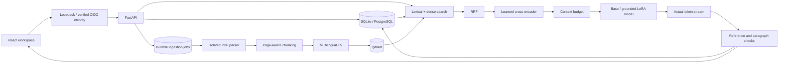

# Architecture and invariants

## Identity and isolation

Workspace and user identifiers come from server-controlled local identity or verified OIDC claims.
Payloads cannot override them. Documents are shared within a workspace. Conversations are private
to a user in that workspace. Qdrant applies tenant/collection filters, followed by a relational
authorization and active-document check before any passage reaches the model.

## Ingestion and consistency

Uploads are size bounded, stored under generated identifiers, and deduplicated by content hash
within active workspace collections. Background jobs are durable relational rows. Claims use
atomic state changes and a lease. Interrupted vector writes can be retried using deterministic IDs.

PDF parsing runs in a child process with a 768 MiB Linux address-space limit, CPU budget and
25-second wall timeout. Extracted text and page counts are bounded. Scanned-image PDFs require OCR.

Documents become retrievable only after vectors, relational chunks, and the lexical index are
ready. Deletion first revokes relational visibility, then schedules vector/file cleanup. Orphaned
vectors therefore cannot disclose deleted source text. Historical answers remain until their
conversations are deleted; historical citation text is hydrated only from currently active sources.

## Retrieval

E5 uses explicit query/passage prefixes in every language. Its pinned revision identifies the vector
collection, so incompatible embedding versions do not silently share an index. Native lexical
search uses SQLite FTS5/BM25 or PostgreSQL simple-dictionary full-text ranking. RRF combines ranked
candidates without equating incomparable score scales. The multilingual cross-encoder reranks
question/passage pairs. Relevance logits are not confidence probabilities.

The configured rejection threshold needs validation against the target corpus. Ranking quality
must be measured on representative documents, including multilingual and unsupported questions.

## Generation and persistence

Context budgeting removes older history and lower-ranked passages before generation. The local
runtime serializes model execution and bounds admitted requests. Only one answer can be active
per conversation, enforced by a database index. Request IDs prevent duplicate message writes.

SSE transmits real generated text, marked as a draft. Final references must point to the selected
passages, and factual paragraphs must contain references. Invalid output is replaced with an
error and is not saved as a verified answer. These checks establish structural reference validity,
not semantic faithfulness. Prompt injection and hallucination remain evaluation concerns.

## Training versus retrieval

The LoRA objective trains the generator's answer behavior. The embedding and reranking models
are pretrained, pinned components, not custom fine-tuned models. Supervision covers answer tokens
only. The original model weights stay frozen. The adapter learns from changing counterfactual
policy values and must still consume context at inference time.

## Operational limits

Embedded Qdrant takes a local process lock; run one application process in this mode. PostgreSQL
plus server Qdrant provides a shared persistence path. The current worker is an in-process durable
poller, not a dedicated distributed worker fleet. Queue leases recover abandoned work after ten
minutes; deterministic writes make replay safe. Failed document jobs expose a manual retry.
The v0.2 schema is bootstrapped idempotently; future schema changes require versioned migrations.
